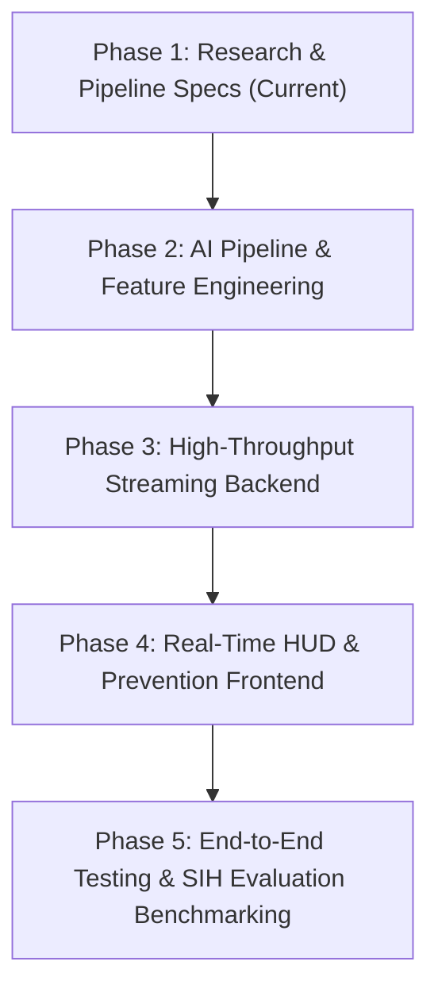

# VoiceShield AI (SIH 2026 - Problem Statement: AICTE Cyber Security Cell)

> **Real-Time Detection and Prevention of AI-Powered Voice Cloning & Synthetic Impersonation Attacks**  
> *Developed for 3rd Year Minor Project & Smart India Hackathon (SIH) 2026*

---

## 🎯 Project Overview
With the rapid proliferation of zero-shot neural voice cloning models (e.g., ElevenLabs, XTTS-v2, VALL-E, HiFi-GAN), bad actors can clone executive, governmental, or family voices from as little as 3 seconds of audio. These synthetic voices are deployed in high-pressure social engineering attacks over VoIP, cellular calls, and enterprise meetings to bypass standard security and authorize fraudulent transactions.

**VoiceShield AI** is an enterprise-ready, low-latency (<300ms) audio integrity verification platform that continuously listens to active audio streams, inspects acoustic micro-artifacts and biomechanical speech dynamics, calculates a real-time **Dynamic Impersonation Risk Score**, and triggers defensive actions (transaction holds, supervisory step-up MFA).

---

## 📑 Research & Architectural Documentation

The project research, innovation models, and pipelining specifications are organized into the following documents:

| Document | Description |
| :--- | :--- |
| **[01_RESEARCH_PROBLEM_AND_INNOVATION.md](file:///c:/codes/Project/docs/01_RESEARCH_PROBLEM_AND_INNOVATION.md)** | Problem landscape, threat vectors, why conventional defenses fail, and our **5 core innovations**. |
| **[02_AI_ML_PIPELINE_DESIGN.md](file:///c:/codes/Project/docs/02_AI_ML_PIPELINE_DESIGN.md)** | Deep learning models (AASIST, Wav2Vec 2.0, LFCC/CQCC), sliding window DSP, and vocoder artifact detection. |
| **[03_SYSTEM_ARCHITECTURE_AND_PIPELINING.md](file:///c:/codes/Project/docs/03_SYSTEM_ARCHITECTURE_AND_PIPELINING.md)** | Unified end-to-end pipeline linking **AI Engine ↔ Backend Streaming Broker ↔ Frontend Real-Time HUD**. |
| **[04_INDIAN_CONTEXT_DATASETS_AND_COMPLIANCE.md](file:///c:/codes/Project/docs/04_INDIAN_CONTEXT_DATASETS_AND_COMPLIANCE.md)** | Indian accent resilience, Indic voice cloning models, lossy telecom codec invariance, and DPDP Act 2023 compliance. |
| **[FRONTEND_IMPLEMENTATION_PLAN.md](file:///c:/codes/Project/docs/FRONTEND_IMPLEMENTATION_PLAN.md)** | Dedicated frontend blueprint: Feature/Sub-Feature modular architecture, 60fps canvas visualizers, dynamic risk gauge, and prevention controls. |

---

## 🚀 Key Innovation Highlights (Beyond Baseline SIH)

1. **Dual-Stream Temporal & Biomechanical Fusion**: Evaluates both spectral synthesis artifacts and human vocal-tract physical constraints (micro-jitter, shimmer, glottal pulse timing).
2. **Neural Vocoder Footprint Fingerprinting**: Identifies phase discrepancies and high-frequency ghost harmonics characteristic of neural vocoders like HiFi-GAN, BigVGAN, and MelGAN.
3. **Context-Aware Dynamic Risk Engine**: Correlates the live acoustic spoof score with contextual keyword markers (e.g., "transfer immediately", "urgent wire", OTP requests).
4. **Zero-Audio-Retention Edge Privacy**: Raw voice data is processed entirely in volatile RAM buffers and discarded within 400ms. Only anonymous math embeddings are retained, fully adhering to India's **DPDP Act 2023**.
5. **Telecom Codec Invariant Modeling**: Robust against GSM, AMR-WB, and VoLTE compression common in Indian telecommunications networks.

---

## 🗺️ Project Execution Roadmap

---

## 👥 Core Project Team

| Team Member | Core Focus & Responsibilities | Key Contributions |
| :--- | :--- | :--- |
| **Gourav** | **Project Handling & Engineering Lead** | End-to-end project orchestration, milestone tracking, core system integration, and deployment delivery. |
| **Shivang Sharma** | **Presentation & Ideation Lead** | Threat vector ideation, conceptual UX workflows, defense architecture storytelling, and project presentation. |
| **Punar Vasu** | **Research & Documentation Lead** | Acoustic vulnerability research, dataset benchmarking, DPDP Act 2023 compliance, and academic whitepapers. |

