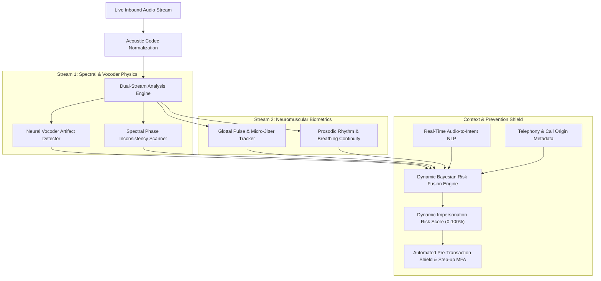

# Research Analysis: AI Voice Cloning Impersonation & Novel Innovations

> **Document ID:** `DOC-RES-01`  
> **Topic:** Comprehensive Threat Landscape Analysis, Limitations of Existing Defenses, and Novel Innovation Strategy  
> **Target Alignment:** AICTE (Cyber Security Cell) - SIH 2026 / Minor Project Evaluators

---

## 1. Problem Statement Deep Dive

### 1.1 The Threat Landscape
Recent advances in generative deep learning (autoregressive transformers, diffusion models, and neural vocoders) have commoditized voice cloning. Modern zero-shot Text-to-Speech (TTS) and Voice Conversion (VC) architectures (such as ElevenLabs, XTTS-v2, Tortoise-TTS, F5-TTS, and OpenVoice) can synthesize convincing human speech with high acoustic resemblance using as little as **3 to 10 seconds of reference audio**.

```
Reference Voice Sample (3-10s)
            │
            ▼
┌───────────────────────────┐
│ Speaker Encoder (d-vector)│ ────► Generates Speaker Embedding
└───────────────────────────┘
            │
            ▼
┌───────────────────────────┐
│ Acoustic Model (DiT / LLM)│ ────► Predicts Mel-Spectrogram
└───────────────────────────┘
            │
            ▼
┌───────────────────────────┐
│ Neural Vocoder (HiFi-GAN) │ ────► Converts Spectrogram to 16kHz/48kHz Waveform
└───────────────────────────┘
            │
            ▼
Convincing Real-Time Audio Stream over VoIP / Cellular
```

### 1.2 High-Risk Attack Scenarios
1. **CXO / Executive Impersonation (Whaling):** Attackers clone the voice of a CEO, CFO, or senior government official, calling finance managers to authorize immediate high-value wire transfers under the guise of an "urgent acquisition" or "confidential government audit".
2. **Virtual Kidnapping & Family Distress Fraud:** Cloned voices of children or relatives claiming to be in custody, medical distress, or accident scenarios to extort immediate ransom.
3. **Banking Call-Center Social Engineering:** Attackers bypass frontline customer support agents and interactive voice response (IVR) systems, impersonating authorized account holders.
4. **Privileged Escalation in Enterprise Workflows:** Bypassing verbal authorization steps for IT credentials reset, database access, or server credentials.

---

## 2. Why Conventional Telephony Defenses Fail

Existing voice security and telephony defenses are fundamentally ill-equipped for real-time generative attacks:

| Traditional Defense | Mechanism | Why It Fails Against AI Voice Cloning |
| :--- | :--- | :--- |
| **Caller ID (CLI)** | Phone number verification | Trivial to spoof using standard VoIP SIP trunking and web PBX providers. |
| **Manual Call-Back** | Calling back the registered number | Attackers employ SIM swap, busy-line jamming, or social pressure claiming they are calling from an alternate emergency number. |
| **Traditional Voice Biometrics (ASV)** | Comparing voice to enrolled template | Conventional Automatic Speaker Verification (ASV) models verify *who* is speaking, not *whether the speech is natural or synthetic*. Clones intentionally duplicate the target's voice timbre! |
| **Static Audio File Scanners** | Uploading `.wav` to an offline analyzer | Only functions *post-incident*. Takes 5–15 seconds to process; financial fraud occurs in real time during the call. |
| **Human Intuition & Familiarity** | Listening for "robotic" artifacts | Modern neural vocoders incorporate realistic breathing sounds, hesitation fillers ("um", "ah"), and natural intonation that deceive human ears under stress. |

---

## 3. Technical Bottlenecks in Existing Academic Deepfake Detectors

1. **High In-the-Wild Latency:** Most academic models (e.g., full-sized RawNet2 or Wav2Vec 2.0 XLSR) require 3 to 6 seconds of static audio to deliver a reliable verdict, introducing an unacceptable delay in a live conversation.
2. **Channel Distortion & Codec Degradation:** Models trained on pristine studio audio (like ASVspoof 2019 LA) experience high False Positive Rates (FPR) when exposed to lossy telecom codecs (AMR 4.75kbps, GSM-FR, Opus 8kbps) common in Indian mobile networks.
3. **Linguistic & Accent Brittleness:** Models struggle with Indian English, regional accents (Bhojpuri, Tamil, Bengali, Marathi, Punjabi), and rapid code-switching ("Hinglish"), misclassifying natural speech variations as synthetic anomalies.
4. **Binary Static Scoring:** A static "Real / Fake" classification fails to capture the progressive risk during a conversation, where an attacker may interleave genuine pre-recorded audio with live neural generation.

---

## 4. Our 5 Core Innovations (The Competitive Edge)

To solve these industry bottlenecks, **VoiceShield AI** introduces five novel architectural breakthroughs:



### 💡 Innovation 1: Dual-Stream Neuro-Acoustic Fusion
* **Stream A (Acoustic Spectral Artefact Analysis):** Detects high-frequency cutoff, unnatural phase alignment, and mel-bin quantization patterns unique to neural speech synthesis.
* **Stream B (Neuromuscular Biomechanics):** Human speech is produced by physical air passing through vocal folds with micro-muscle tremors, variable subglottal pressure, and involuntary jitter ($0.5\% - 1.0\%$) and shimmer ($1.0\% - 3.0\%$). Synthesized voices often present mathematically over-smoothed or unnaturally jittered glottal excitation pulses.
* **Fusion:** Combining these streams prevents false alarms on noisy lines and exposes even high-fidelity clones.

### 💡 Innovation 2: Neural Vocoder Footprint Fingerprinting
Neural vocoders (HiFi-GAN, BigVGAN, MelGAN, SoundStream) rely on transposed 1D/2D convolutions with fixed upsampling ratios. These operations leave distinct periodic artifacts in the high-frequency phase spectrum—analogous to a digital camera sensor's PRNU (Photo-Response Non-Uniformity). VoiceShield AI computes the **Instantaneous Phase Discrepancy (IPD)** to spot vocoder footprints within 250 milliseconds.

### 💡 Innovation 3: Context-Aware Dynamic Risk Trajectory
Unlike static detectors, VoiceShield AI tracks a sliding **Risk Trajectory**:
* If a caller's voice integrity score drops *at the exact moment* high-risk semantic keywords are spoken (e.g., *"approve wire transfer"*, *"bypass OTP"*, *"confidential transfer"*), the risk score surges exponentially.
* Lowers false alarm fatigue during harmless banter while maximizing sensitivity during transactional decision moments.

### 💡 Innovation 4: Zero-Audio-Retention Edge Privacy (DPDP Act 2023 Compliant)
In compliance with the **Digital Personal Data Protection (DPDP) Act of India 2023**:
* Raw audio samples are kept solely in volatile circular RAM buffers for 300ms chunks and wiped immediately after mathematical feature extraction.
* No audio is written to disk or transmitted to central cloud repositories. Only anonymized mathematical tensors and risk logs are retained.

### 💡 Innovation 5: Telephony Codec Invariance Pipeline
We subject training and calibration pipelines to synthetic codec distortion simulating Indian telecom environments:
* **GSM-FR (13 kbps)**
* **AMR-NB (Adaptive Multi-Rate Narrowband 4.75 - 12.2 kbps)**
* **AMR-WB (G.722.2 - VoLTE Wideband)**
* **Opus / WebRTC Adaptive Bitrate**
This ensures the model learns real synthetic artifacts rather than confusing cellular network packet compression with deepfake manipulation.

---

## 5. Comparative Evaluation Matrix

| Feature | Standard Open-Source Cloned Voice Detectors | Enterprise Call Biometrics (Traditional ASV) | **VoiceShield AI (Our Solution)** |
| :--- | :--- | :--- | :--- |
| **Inference Latency** | 2,000ms – 5,000ms (Batch file) | 3,000ms – 7,000ms | **< 300ms (Streaming Micro-chunks)** |
| **Vocoder Fingerprinting** | ❌ None | ❌ None | **✅ Instantaneous Phase Analysis** |
| **Neuromuscular Prosody** | ❌ None (Only Mel-Spectrogram) | ⚠️ Basic pitch comparison | **✅ Glottal pulse & Jitter/Shimmer dynamics** |
| **Contextual Intent Fusion** | ❌ Ignorant of call intent | ❌ Ignorant of call intent | **✅ Dynamic Semantic + Acoustic Risk Weighting** |
| **Telecom Codec Invariance** | ❌ Severe degradation on 2G/VoLTE | ⚠️ Moderate degradation | **✅ Robust multi-codec calibration** |
| **Privacy Compliance** | ⚠️ Often stores audio files | ⚠️ Stores raw voiceprints | **✅ Zero-Retention, DPDP Act 2023 Compliant** |
| **Indian Dialect Support** | ❌ High FPR on regional accents | ❌ Accent-dependent | **✅ Language-agnostic acoustic phase modeling** |
