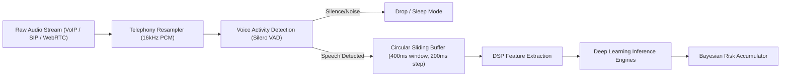
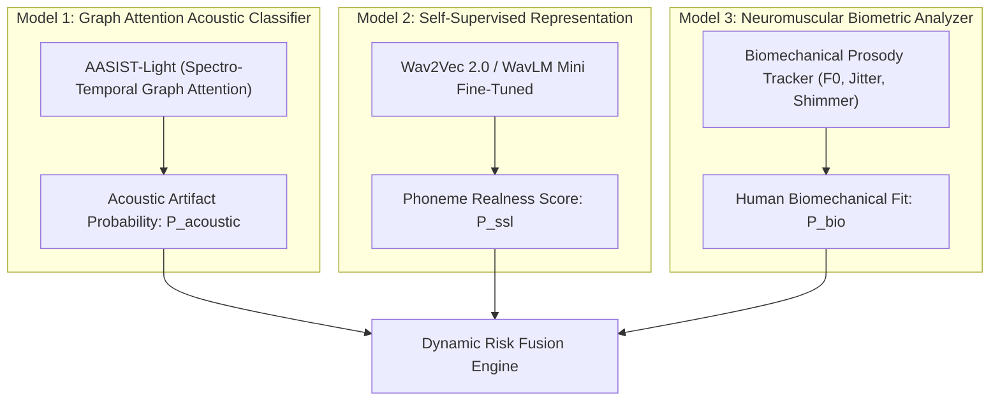

# AI/ML Pipeline Design & Acoustic Architecture

> **Document ID:** `DOC-AI-02`  
> **Topic:** Real-Time Signal Processing, Neural Architectures, Feature Engineering, and Dynamic Risk Fusion  
> **Target Alignment:** Sub-300ms End-to-End Latency & Production-Ready Scalability

---

## 1. End-to-End Audio Ingestion & Preprocessing Pipeline

The streaming audio pipeline processes live telephony/VoIP audio continuously through a low-latency sliding window:



### 1.1 Ingestion Specifications
* **Audio Input Format:** Mono PCM 16-bit, sampled at 8kHz, 16kHz, or 48kHz.
* **Resampling Stage:** Fast polyphase filter resampling to uniform **16,000 Hz**.
* **Voice Activity Detection (VAD):** Ultra-lightweight **Silero VAD v4** filter (<2ms execution time per 30ms frame) to bypass computational load during pauses and channel silence.
* **Chunking Geometry:**
  * **Window Size:** $T_w = 400\,\text{ms}$ (6,400 audio samples at 16kHz).
  * **Hop / Step Size:** $T_h = 200\,\text{ms}$ (3,200 samples).
  * **Update Frequency:** New risk estimate emitted every **200 milliseconds**.

---

## 2. Digital Signal Processing (DSP) & Feature Engineering

To expose neural synthesis flaws, three complementary feature representations are extracted simultaneously:

```
                      400ms Speech Chunk
                               │
       ┌───────────────────────┼───────────────────────┐
       ▼                       ▼                       ▼
┌──────────────┐       ┌──────────────┐       ┌──────────────┐
│  LFCC & CQCC │       │ Phase & MGD  │       │ SSL Acoustic │
│ Filterbanks  │       │ Spectrogram  │       │  Embeddings  │
└──────────────┘       └──────────────┘       └──────────────┘
```

### 2.1 Linear Frequency Cepstral Coefficients (LFCC)
* **Rationale:** Human ears focus on lower frequencies (Mel scale), but neural speech synthesizers (like HiFi-GAN and BigVGAN) leave high-frequency artifacts (above 4kHz) due to transposed convolution upsampling.
* **Mechanism:** Linear filterbank with 60 filters linearly spaced across 0 Hz to 8,000 Hz, followed by Discrete Cosine Transform (DCT) to yield 20 static cepstral coefficients + delta + double-delta features (60 dimensions).

### 2.2 Constant-Q Cepstral Coefficients (CQCC)
* **Rationale:** CQCC uses a geometrically spaced frequency distribution with higher spectral resolution at low frequencies and higher temporal resolution at high frequencies.
* **Target:** Exposes abnormal vocal-tract resonances and glottal flow impulse inconsistencies.

### 2.3 Instantaneous Phase & Modified Group Delay (MGD)
* **Rationale:** Generative TTS models struggle to synthesize natural phase spectra; they optimize magnitude spectra and rely on vocoders to approximate phase.
* **Metric:** 
  $$\tau(\omega) = -\frac{d \theta(\omega)}{d\omega}$$
  Unnatural phase discontinuities immediately register as high-energy spikes in the group delay display.

---

## 3. Deep Learning Model Architectures

VoiceShield AI leverages a **tri-model ensemble** balancing raw accuracy with microsecond inference:



### 3.1 Model 1: AASIST-Light (Audio Anti-Spoofing using Integrated Spectro-Temporal Graph Attention)
* **Architecture:** Raw waveform or combined LFCC input passed through 6-layer residual CNN, followed by dual graph attention modules:
  * **Spectral Graph Attention:** Models correlation across frequency bins.
  * **Temporal Graph Attention:** Models transitions across time frames.
* **Footprint:** ~1.2 million parameters (~4.8 MB in INT8 ONNX format).
* **Latency:** ~18ms on a standard Intel/AMD CPU, ~3ms on GPU.

### 3.2 Model 2: SSL Representation (WavLM-Mini / Wav2Vec 2.0 Distilled)
* **Architecture:** 4-layer distilled self-supervised transformer pre-trained on 10,000+ hours of speech.
* **Output:** Captures subtle contextual phoneme transition anomalies where synthetic voices create unnatural co-articulation.
* **Footprint:** ~15 MB quantized.
* **Latency:** ~25ms on CPU.

### 3.3 Model 3: Neuromuscular Biometric Tracker (Prosody & Glottal Dynamics)
* **Extracted Biometrics:**
  1. **Fundamental Frequency ($F_0$) Continuity:** Tracks vocal fold vibration frequency and slope variance.
  2. **Vocal Jitter (Period Perturbation Quotient - PPQ):** Cycle-to-cycle variation in fundamental frequency (Human baseline: $0.4\% - 1.0\%$; TTS often shows $<0.2\%$ or synthetic noise $>2.5\%$).
  3. **Vocal Shimmer (Amplitude Perturbation Quotient - APQ):** Cycle-to-cycle variation in amplitude (Human baseline: $1.0\% - 3.5\%$).
  4. **Harmonics-to-Noise Ratio (HNR):** Ratio of glottal periodic signal to turbulent glottal airflow noise.

---

## 4. Real-Time Dynamic Risk Fusion Engine

A single audio frame can suffer from network dropouts or ambient noise. To eliminate false triggers, VoiceShield AI uses a **Temporal Bayesian Accumulator** with semantic context scaling:

```
                   ┌──────────────────────────────────────────────┐
                   │  Instantaneous Spoof Probability P_raw(t)    │
                   └──────────────────────┬───────────────────────┘
                                          │
                                          ▼
┌─────────────────────────────────────────────────────────────────────────────────┐
│                    Exponential Moving Average (EMA) Smoothing                    │
│                 S_smooth(t) = λ · S_smooth(t-1) + (1 - λ) · P_raw(t)             │
└─────────────────────────────────────────┬───────────────────────────────────────┘
                                          │
                                          ▼
┌─────────────────────────────────────────────────────────────────────────────────┐
│                     Semantic Risk Multiplier (Context Engine)                    │
│                   Risk_final(t) = Clip( S_smooth(t) · W_context(t) )             │
└─────────────────────────────────────────┬───────────────────────────────────────┘
                                          │
                                          ▼
                      Dynamic Impersonation Risk Score: 0 - 100%
```

### 4.1 Risk Score Formulation

$$S_{\text{raw}}(t) = w_1 \cdot P_{\text{acoustic}}(t) + w_2 \cdot P_{\text{ssl}}(t) + w_3 \cdot (1 - P_{\text{bio}}(t))$$

Where weights are empirically tuned:
* $w_1 = 0.45$ (Acoustic / Spectral Artifacts)
* $w_2 = 0.35$ (Self-Supervised Synthesized Phoneme Detection)
* $w_3 = 0.20$ (Biomechanical Neuromuscular Deviation)

### 4.2 Semantic Context Multiplier ($W_{\text{context}}$)
When the real-time Intent module flags high-risk transactional phrases, the sensitivity multiplier dynamically scales:
* **Standard conversation:** $W_{\text{context}} = 1.0$
* **Urgency markers (*"immediate"*, *"urgent"*, *"critical audit"*):** $W_{\text{context}} = 1.15$
* **Financial execution markers (*"wire fund"*, *"approve RTGS"*, *"read OTP"*):** $W_{\text{context}} = 1.35$

### 4.3 Risk Classification Tiers

| Dynamic Score Range | Risk Level | System Action & Intervention |
| :---: | :---: | :--- |
| **0% – 34%** | 🟢 **GENUINE / LOW** | Silent monitoring; normal call progression. |
| **35% – 69%** | 🟡 **SUSPICIOUS** | Real-time warning badge on UI; prompt user to ask a challenge question. |
| **70% – 100%** | 🔴 **CRITICAL CLONE ALERT** | **Immediate Intervention:** Step-up biometric MFA required, pre-transaction freeze triggered, alert sent to compliance supervisor. |

---

## 5. Latency Budget (Target: < 300ms)

| Pipeline Step | Latency (CPU) | Latency (GPU/Edge NPU) |
| :--- | :---: | :---: |
| Network Transport (WebRTC / WebSocket frame arrival) | 30 ms | 30 ms |
| Resampling & VAD | 5 ms | 5 ms |
| Sliding Window Accumulation ($T_h$) | 200 ms | 200 ms |
| DSP Feature Extraction (LFCC + Phase) | 12 ms | 4 ms |
| AASIST-Light ONNX Inference | 18 ms | 3 ms |
| WavLM-Mini Distilled Inference | 24 ms | 6 ms |
| Dynamic Fusion & Context Scoring | 2 ms | 1 ms |
| Alert Broadcast to Frontend | 5 ms | 5 ms |
| **Total End-to-End Latency** | **~296 ms** | **~254 ms** |

*Result:* The system produces an actionable alert within **under one third of a second**, well before any banking transaction or sensitive verbal agreement can be completed.
