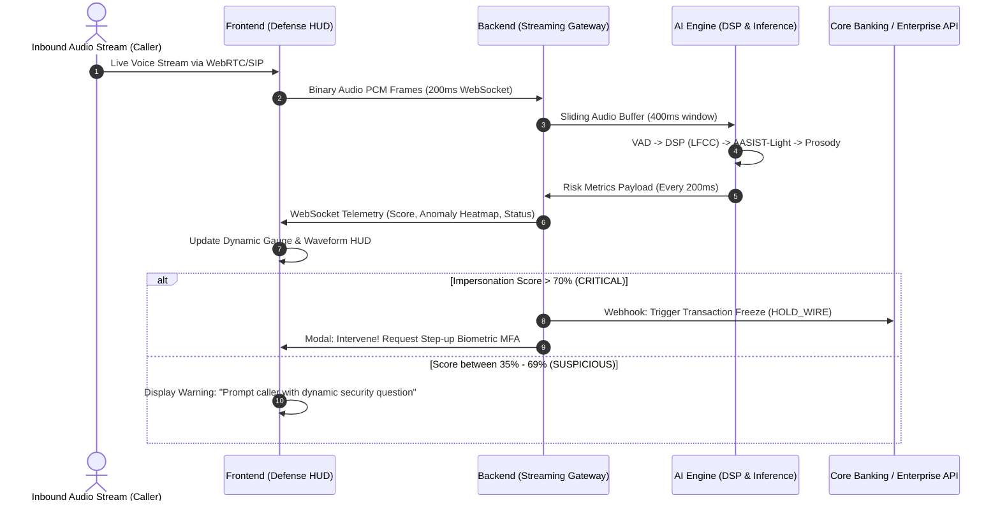

# System Architecture & Unified Pipelining Format

> **Document ID:** `DOC-ARCH-03`  
> **Topic:** Unified Pipelining Flow (AI Engine ↔ Backend ↔ Frontend), Protocol Contracts, and Modular Folder Blueprint  
> **Target Alignment:** Production-Grade Modular Engineering & Real-Time Event Architecture

---

## 1. High-Level System Architecture

The VoiceShield AI architecture consists of three tightly coupled, asynchronous subsystems:
1. **Frontend Presentation & Real-Time Defense HUD** (Browser WebRTC / Desktop VoIP overlay).
2. **Backend Streaming & Event Broker** (High-throughput WebSocket gateway, session state manager, alerting dispatcher).
3. **AI/ML Audio Inference Pipeline** (DSP feature extraction, acoustic classification, biomechanical prosody, and Bayesian risk fusion).



---

## 2. Real-Time Communication & Data Protocols

### 2.1 Inbound Audio Stream (Frontend / PBX ➔ Backend)
* **Transport:** WebSocket (`wss://host/api/v1/stream/audio/{call_id}`)
* **Format:** Raw Binary 16-bit Linear PCM (16kHz, mono).
* **Frame Interval:** Emitted every 200ms (3,200 samples = 6,400 bytes).

### 2.2 Telemetry & Risk Event Bus (Backend ➔ Frontend)
* **Transport:** WebSocket (`wss://host/api/v1/stream/telemetry/{call_id}`)
* **Format:** High-speed JSON telemetry emitted on every evaluated hop:

```json
{
  "timestamp": 1728745200150,
  "call_id": "CALL-2026-X892",
  "caller_number": "+91 98765 43210",
  "evaluation_window_ms": 400,
  "dynamic_risk_score": 87.4,
  "risk_level": "CRITICAL_SPOOF",
  "confidence": 0.94,
  "diagnostics": {
    "acoustic_anomaly_score": 0.91,
    "vocoder_footprint_detected": true,
    "vocoder_type_signature": "HiFi-GAN_v1",
    "jitter_ppq": 0.08,
    "shimmer_apq": 0.42,
    "human_biomechanical_consistency": 0.12
  },
  "context": {
    "suspicious_keywords_flagged": ["urgent wire transfer", "bypass verification"],
    "transaction_context_multiplier": 1.35
  },
  "recommended_action": "FREEZE_TRANSACTION_AND_ESCALATE"
}
```

### 2.3 REST API Endpoints

| Method | Endpoint | Description |
| :--- | :--- | :--- |
| `POST` | `/api/v1/calls/initiate` | Registers a new monitored voice session with caller metadata. |
| `POST` | `/api/v1/calls/{id}/freeze` | Triggers immediate automated transaction freeze on banking core. |
| `POST` | `/api/v1/calls/{id}/step-up-mfa` | Dispatches SMS / Push notification out-of-band verification challenge. |
| `GET` | `/api/v1/calls/{id}/audit-trail` | Retrieves the immutable mathematical risk trajectory for regulatory compliance. |
| `GET` | `/api/v1/incidents` | Lists flagged synthetic impersonation attempts with threat analytics. |

---

## 3. Production-Ready Feature-Driven Folder Blueprint

Following your requirement, when we implement each section, we will structure it strictly by **Feature / Sub-Feature / Files**. Below is the architectural blueprint of how our single unified codebase will be structured:

```text
VoiceShield-AI/
├── docs/                                   # Research, specifications, and pipeline docs
│   ├── 01_RESEARCH_PROBLEM_AND_INNOVATION.md
│   ├── 02_AI_ML_PIPELINE_DESIGN.md
│   ├── 03_SYSTEM_ARCHITECTURE_AND_PIPELINING.md
│   └── 04_INDIAN_CONTEXT_DATASETS_AND_COMPLIANCE.md
│
├── ai_pipeline/                            # AI/ML Core (Python / PyTorch / ONNX)
│   └── src/
│       ├── core/                           # Shared DSP math, configs, models base
│       └── features/
│           ├── audio_ingestion/            # Sub-feature: VAD, resampler, circular buffers
│           │   ├── vad_detector.py
│           │   └── stream_buffer.py
│           ├── dsp_features/               # Sub-feature: LFCC, CQCC, phase spectra
│           │   ├── lfcc_extractor.py
│           │   └── phase_analyzer.py
│           ├── neural_detection/           # Sub-feature: AASIST & vocoder artifact classifiers
│           │   ├── aasist_classifier.py
│           │   └── vocoder_fingerprint.py
│           ├── biomechanical_prosody/      # Sub-feature: Vocal jitter, shimmer & pitch F0
│           │   ├── jitter_shimmer.py
│           │   └── vocal_tract_filter.py
│           └── risk_fusion/                # Sub-feature: Bayesian accumulator & scoring
│               ├── bayesian_accumulator.py
│               └── dynamic_scorer.py
│
├── backend/                                # High-Throughput Streaming Server (Node / FastAPI)
│   └── src/
│       ├── core/                           # Configs, DB connectors, middleware
│       └── features/
│           ├── audio_stream_gateway/       # Sub-feature: WebSocket ingestion of live audio
│           │   ├── stream_handler.js/.py
│           │   └── connection_manager.js/.py
│           ├── risk_engine/                # Sub-feature: Pipeline coordinator & context scaler
│           │   ├── score_calculator.js/.py
│           │   └── semantic_keyword_watcher.js/.py
│           ├── alert_dispatcher/           # Sub-feature: Real-time broadcast & SMS/Email alerts
│           │   ├── websocket_broadcaster.js/.py
│           │   └── emergency_notifier.js/.py
│           └── transaction_shield/         # Sub-feature: Banking webhooks & kill-switch API
│               ├── banking_webhook.js/.py
│               └── freeze_controller.js/.py
│
└── frontend/                               # Real-Time Defense HUD & Analytics (Modern UI)
    └── src/
        ├── core/                           # CSS design tokens, audio capture worklet
        └── features/
            ├── live_call_hud/              # Sub-feature: Active call header & caller telemetry
            │   ├── CallHeader.jsx/.tsx
            │   └── CallControls.jsx/.tsx
            ├── dynamic_risk_gauge/         # Sub-feature: Animated 0-100% risk meter with alert tiers
            │   ├── RiskGauge.jsx/.tsx
            │   └── RiskGauge.css
            ├── waveform_spectrogram/       # Sub-feature: Real-time live audio & phase artifact canvas
            │   ├── LiveWaveform.jsx/.tsx
            │   └── SpectrogramHeatmap.jsx/.tsx
            ├── prevention_actions/         # Sub-feature: Step-up MFA, Freeze Wire, Challenge modals
            │   ├── ActionModal.jsx/.tsx
            │   └── FreezeTrigger.jsx/.tsx
            └── incident_audit_log/         # Sub-feature: Historical logs & exportable compliance report
                ├── AuditTable.jsx/.tsx
                └── ThreatReportModal.jsx/.tsx
```

---

## 4. Key Engineering Design Principles

1. **Strict Feature Encapsulation:** Every feature contains its own models, components, utilities, and tests. A developer or evaluator can inspect `features/neural_detection` and understand the entire detection mechanism in isolation.
2. **Backpressure & Micro-Chunk Queuing:** If the AI pipeline faces transient load spikes, the backend drops old silence frames using VAD rather than accumulating unbounded network lag.
3. **Graceful Fallback:** If high-grade GPU inference is unavailable, the pipeline falls back to an ultra-fast CPU-optimized quantized ONNX runtime executing only LFCC + AASIST-Light without interrupting the live call stream.
