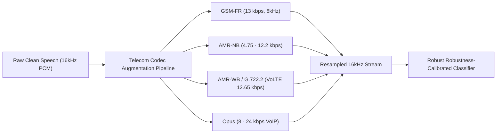

# Indian Telecom Context, Datasets & DPDP Compliance

> **Document ID:** `DOC-REG-04`  
> **Topic:** Multilingual Indian Accents, Telecom Codec Robustness, Datasets, and DPDP Act 2023 Compliance  
> **Target Alignment:** AICTE Cyber Security Cell & Indian Cybersecurity Frameworks

---

## 1. Multilingual Indian Context & Accent Robustness

### 1.1 The Challenge of Indian Telephony
India has over **22 scheduled languages** and hundreds of regional dialects. Telephonic speech in India exhibits distinct acoustic challenges:
1. **Retroflex Consonant Articulation:** Retroflex stops (/ʈ/, /ɖ/) common in Indic languages (Hindi, Tamil, Telugu, Punjabi, etc.) generate sharper high-frequency energy bursts than standard Western speech corpora.
2. **Syllable-Timed Rhythm:** Many Indian languages follow syllable-timed prosody rather than the stress-timed prosody of Western English. Generic foreign deepfake models often flag natural Indian English cadences as "unnatural prosody".
3. **Pervasive Code-Switching ("Hinglish", "Tanglish"):** Speakers rapidly switch between Hindi/regional languages and English within the same sentence.

```
"Sir, maine transfer initiate kar diya hai, please OTP approve kijiye..."
 └── Indic Prosody ──┘└── English Lexicon ──┘└── Indic Grammar ──┘
```

### 1.2 Our Solution: Language-Agnostic Physics Modeling
Instead of relying strictly on linguistic phonetic decoders, **VoiceShield AI relies on fundamental acoustic physics**:
* **Physical Vocal Tract Biomechanics:** All humans—regardless of whether they speak Hindi, Tamil, or English—generate speech through pulmonary airflow passing through vocal folds with universal involuntary glottal pulse micro-jitters ($0.4\% - 1.0\%$).
* **Vocoder Inversion Invariance:** Neural vocoders (HiFi-GAN, BigVGAN, MelGAN) generate speech through transposed convolutions and periodic pitch estimators. The artifacts left by these neural mathematical operations are **identical across all languages**.
* **Indic-Calibrated Prosodic Baseline:** We normalize fundamental frequency ($F_0$) contours against speech models calibrated on native Indic datasets (AI4Bharat Kathbath / IndicTTS).

---

## 2. Indian Telecom Channel Robustness & Codec Augmentation

In India, a substantial volume of voice calls traverse legacy **2G GSM networks, 3G AMR-NB**, and variable-bitrate **VoLTE / VoNR**. Lossy compression codecs discard high frequencies and introduce quantization noise that trips naive deepfake detectors.

### 2.1 Codec Simulation & Training Matrix
To achieve true codec invariance, training audio undergoes automated data augmentation across simulated telecom pipelines:



| Codec | Bitrate | Typical Indian Deployment | Acoustic Impact Simulated |
| :--- | :--- | :--- | :--- |
| **GSM-FR** | 13.0 kbps | Rural 2G cellular | Band-limited 300Hz–3400Hz, steep 4kHz cutoff |
| **AMR-NB** | 4.75 – 12.2 kbps | 2G / 3G fallback | Frame loss, algebraic codebook quantization |
| **AMR-WB (G.722.2)** | 12.65 – 23.85 kbps | Indian 4G VoLTE (Jio, Airtel, Vi) | Extended 50Hz–7000Hz, linear prediction noise |
| **Opus (CELT/SILK)** | 6 – 32 kbps | WhatsApp / Telegram / Teams VoIP | Variable frame sizes, adaptive bitrate jitter |

---

## 3. Training & Benchmarking Datasets

To ensure rigorous validation for SIH and college evaluation benchmarks, the system is calibrated using both international gold standards and curated Indic datasets:

### 3.1 Public Deepfake Voice Benchmarks
1. **ASVspoof 2019 / 2021 (Logical Access & Speech Deepfake):** Over 100,000 utterances covering 19 different speech synthesis and voice conversion algorithms.
2. **WaveFake Dataset:** Over 100,000 synthesized audio clips across 6 neural vocoders (MelGAN, HiFi-GAN, WaveGlow, Parallel WaveGAN, Multi-band MelGAN, PWG).
3. **In-the-Wild Audio Deepfake Dataset:** Real-world social media deepfakes with natural background noise and multi-speaker environments.

### 3.2 Indic Speech Datasets
1. **AI4Bharat Kathbath:** Open-source dataset comprising over 1,600 hours of Indian speech across 12 Indian languages with diverse regional accents.
2. **AI4Bharat IndicTTS:** Multilingual text-to-speech corpus used to generate negative control synthetic samples in Hindi, Tamil, Telugu, Marathi, and Bengali.
3. **Synthesized Indic Attack Set:** Custom evaluation set generated using XTTS-v2 and ElevenLabs voice-cloned samples of Indian public figures, passed through simulated Indian telecom codecs.

---

## 4. Privacy & Regulatory Compliance (DPDP Act 2023)

The Government of India's **Digital Personal Data Protection (DPDP) Act, 2023** imposes stringent guidelines regarding biometric and personal data processing. VoiceShield AI is designed from the ground up for **Zero-Audio-Retention**:

```
                       Inbound Audio Stream
                                │
                                ▼
         ┌──────────────────────────────────────────────┐
         │ Volatile Circular RAM Buffer (400ms Window)  │
         └──────────────────────┬───────────────────────┘
                                │  Mathematical Feature Extraction
                                ▼
         ┌──────────────────────────────────────────────┐
         │ Scalar Embedding / Risk Tensor Vector        │
         └──────────────────────┬───────────────────────┘
                                │
                                ▼
         ┌──────────────────────────────────────────────┐
         │  IMMEDIATE BUFFER OVERWRITE (Zero-Fill RAM)  │
         │          Raw Audio Discarded in <400ms       │
         └──────────────────────────────────────────────┘
                                │
                                ▼
         ┌──────────────────────────────────────────────┐
         │ Immutable Compliance Audit Log (Metadata)    │
         │  {Call_ID, Timestamp, Risk_Score, SHA-256}   │
         └──────────────────────────────────────────────┘
```

### 4.1 Key Privacy Safeguards

| DPDP Act 2023 Principle | VoiceShield AI Implementation |
| :--- | :--- |
| **Data Minimization (Sec. 6)** | Raw audio is **never written to disk, database, or secondary storage**. Only 400ms volatile RAM chunks exist temporarily for DSP transformation. |
| **Purpose Limitation (Sec. 4)** | Speech audio is utilized solely for instantaneous real-time authenticity classification and discarded within milliseconds. |
| **On-Premise / Edge Inference** | The AI engine can run locally on edge appliances or on-premise banking servers without streaming voice over external third-party cloud APIs. |
| **Cryptographic Auditability** | Every call creates a tamper-proof audit record containing only a cryptographic hash of the session, the time-stamped risk trajectory, and automated interventions—satisfying RBI and SEBI security audit guidelines without storing personal conversations. |
