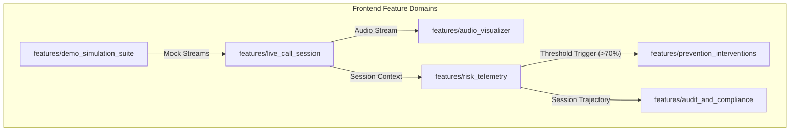

# Frontend Implementation Plan: VoiceShield AI Defense Command Center

> **Document ID:** `PLAN-FE-01`  
> **Target:** VoiceShield AI - Frontline Real-Time Defense HUD & Analytics Console  
> **Structure Standard:** Strict Feature / Sub-Feature Modular Hierarchy  
> **Design Philosophy:** Premium Cyber-Defense Aesthetics (Dark Mode, Glassmorphism, Micro-Animations, 60fps Canvas Visualizers)

---

## 1. Vision & Core Objectives

The frontend of **VoiceShield AI** serves as the **mission-critical frontline interface** for enterprise call-center agents, bank transaction approval officers, and cybersecurity analysts. 

### Key Objectives:
1. **Zero-Cognitive Overload:** Deliver an immediate, glanceable risk verdict within milliseconds of an incoming voice stream.
2. **Sub-300ms Dynamic Telemetry:** Smoothly render incoming risk updates (emitted every 200ms) without UI lag or jank.
3. **60fps Real-Time Audio Canvas:** Display live oscillograms and spectral phase heatmaps directly using HTML5 Canvas to expose neural vocoder footprints visually.
4. **Actionable Pre-Transaction Interventions:** Provide instant one-click defensive controls (Emergency Transaction Freeze, Step-up Biometric MFA, and Dynamic Challenge Prompts).
5. **Interactive Demo Simulation Suite:** Enable hackathon evaluators and college professors to toggle between genuine calls, AI clones, and noisy telecom audio with one click.

---

## 2. Feature & Sub-Feature Architecture

Following the modular requirement (**`features/<feature>/<sub-feature>/`**), the frontend is partitioned into self-contained domains:



---

## 3. Detailed Feature Breakdown

### 🎯 Feature 1: `live_call_session` (Call Ingestion & Session Control)
Manages the active call lifecycle, caller metadata, and audio stream acquisition.

* **Sub-Feature 1.1: `call_telemetry_bar/`**
  * Displays caller ID, verified contact status, caller geography, active telecom network (e.g., `VoLTE / AMR-WB`, `2G GSM`, `WebRTC VoIP`), call duration timer, and encrypted session hash.
* **Sub-Feature 1.2: `audio_stream_controller/`**
  * Captures live microphone input via HTML5 `AudioContext` and `AudioWorkletNode`.
  * Converts floating-point PCM to 16kHz 16-bit Linear PCM micro-chunks.
  * Provides controls for input device selection, stream muting, and sensitivity calibration.

---

### 🎯 Feature 2: `risk_telemetry` (Dynamic Impersonation Risk HUD)
The visual centerpiece of the application, rendering the live risk verdict and multi-layer diagnostic metrics.

* **Sub-Feature 2.1: `dynamic_risk_meter/`**
  * Radial SVG / Canvas gauge displaying the **Dynamic Impersonation Risk Score ($0\% - 100\%$)**.
  * Dynamic color morphing based on calibrated alert tiers:
    * 🟢 **0% – 34% (GENUINE / LOW RISK):** Emerald green, steady glow.
    * 🟡 **35% – 69% (SUSPICIOUS):** Amber orange, subtle pulsing border.
    * 🔴 **70% – 100% (CRITICAL DEEPFAKE ALERT):** Crimson red, high-frequency alarm pulse animation.
* **Sub-Feature 2.2: `threat_breakdown_card/`**
  * Micro-diagnostic telemetry meters displaying:
    1. **Acoustic Synthesis Artifact Score** ($0 - 100\%$)
    2. **Neural Vocoder Fingerprint** (Match confidence & signature: *HiFi-GAN*, *BigVGAN*, *MelGAN*, or *Clean*)
    3. **Neuromuscular Biometric Fit** (Vocal jitter PPQ & shimmer APQ normalcy)
    4. **Contextual Intent Multiplier** (Real-time highlighted keywords: *"urgent wire"*, *"bypass OTP"*)

---

### 🎯 Feature 3: `audio_visualizer` (High-Performance Wave & Spectrum Display)
Exposes the mathematical difference between human vocal tract acoustics and synthetic audio artifacts visually.

* **Sub-Feature 3.1: `realtime_waveform/`**
  * Hardware-accelerated HTML5 Canvas oscillogram rendering live audio waveforms at 60 frames per second.
  * Real-time color gradient shifting based on instantaneous chunk risk.
* **Sub-Feature 3.2: `spectral_heatmap/`**
  * Real-time Fast Fourier Transform (FFT) spectrogram visualizer.
  * Visually highlights high-frequency cutoff points ($>4\text{kHz}$) and vocoder checkerboard phase patterns.

---

### 🎯 Feature 4: `prevention_interventions` (Proactive Defense & Action Layer)
Provides immediate defensive controls before high-value transactions or confidential disclosures occur.

* **Sub-Feature 4.1: `threat_alert_banner/`**
  * Persistent high-priority banner that slides into view when risk crosses $70\%$.
  * Emits subtle audio cue and visual alert to guarantee operator attention.
* **Sub-Feature 4.2: `transaction_kill_switch/`**
  * Large, protected **"FREEZE TRANSACTION"** emergency trigger.
  * Dispatches an authenticated webhook payload to the banking core or approval workflow to lock active fund transfers.
* **Sub-Feature 4.3: `security_challenge_prompts/`**
  * AI-recommended counter-measures for the human operator to verbally challenge the caller (e.g., *"Ask caller to pronounce a randomized non-dictionary phoneme string"* or *"Request secondary visual confirmation"*).
* **Sub-Feature 4.4: `step_up_mfa_modal/`**
  * One-click trigger dispatching out-of-band biometric push authentication to the genuine caller's registered device.

---

### 🎯 Feature 5: `demo_simulation_suite` (Interactive Evaluator Testbed)
A built-in evaluation bench tailored for college project demonstrations and SIH jury presentations.

* **Sub-Feature 5.1: `sample_loader/`**
  * Quick-switch presets to run instant evaluations without requiring a second phone:
    * 🎙️ **Preset 1:** Genuine Executive Call (Clean 4G VoLTE audio)
    * 🤖 **Preset 2:** ElevenLabs Voice Clone (CEO urgent wire request)
    * 🇮🇳 **Preset 3:** Indic-Accented Hindi Cloned Voice (XTTS-v2 synthesis)
    * 📶 **Preset 4:** Genuine Call over Noisy 2G GSM cellular network
* **Sub-Feature 5.2: `custom_audio_uploader/`**
  * Drag-and-drop `.wav` or `.mp3` audio player allowing evaluators to upload their own voice recordings and test the detector live.

---

### 🎯 Feature 6: `audit_and_compliance` (Audit Trail & DPDP Reporting)
Generates non-repudiation audit trails for compliance with India's DPDP Act 2023.

* **Sub-Feature 6.1: `risk_timeline_chart/`**
  * Interactive time-series line chart tracing the risk score trajectory across the entire call duration.
  * Highlights timestamps where high-risk semantic keywords were detected.
* **Sub-Feature 6.2: `incident_report_export/`**
  * Generates an exportable PDF/JSON Incident Report containing cryptographic hashes, risk timeline, diagnostics, and defensive actions taken—**with zero audio recording retained**.

---

## 4. Frontend Folder Structure Blueprint

When we begin implementation, the frontend folder structure will be created strictly as follows:

```text
frontend/
├── public/
│   ├── favicon.svg
│   └── audio_samples/                      # Evaluation presets (Genuine, Clone, GSM)
├── src/
│   ├── index.html
│   ├── main.jsx
│   ├── App.jsx
│   │
│   ├── core/                               # Global tokens, theme, audio worklets & sockets
│   │   ├── styles/
│   │   │   ├── design_tokens.css           # HSL color variables, cyber dark theme, typography
│   │   │   ├── glassmorphism.css           # Glass card utilities, borders, shadows
│   │   │   └── animations.css              # Alarm pulses, glow transitions, gauge springs
│   │   ├── audio/
│   │   │   ├── audio_context.js            # Web Audio API initialization
│   │   │   └── pcm_worklet_processor.js    # 16kHz PCM downsampler worklet
│   │   └── websocket/
│   │       └── telemetry_socket.js         # Real-time WebSocket listener with auto-reconnect
│   │
│   └── features/                           # Self-contained feature domains
│       │
│       ├── live_call_session/
│       │   ├── call_telemetry_bar/
│       │   │   ├── CallTelemetryBar.jsx
│       │   │   └── CallTelemetryBar.css
│       │   └── audio_stream_controller/
│       │       ├── AudioStreamController.jsx
│       │       └── AudioStreamController.css
│       │
│       ├── risk_telemetry/
│       │   ├── dynamic_risk_meter/
│       │   │   ├── DynamicRiskMeter.jsx
│       │   │   └── DynamicRiskMeter.css
│       │   └── threat_breakdown_card/
│       │       ├── ThreatBreakdownCard.jsx
│       │       └── ThreatBreakdownCard.css
│       │
│       ├── audio_visualizer/
│       │   ├── realtime_waveform/
│       │   │   ├── RealtimeWaveform.jsx
│       │   │   └── RealtimeWaveform.css
│       │   └── spectral_heatmap/
│       │       ├── SpectralHeatmap.jsx
│       │       └── SpectralHeatmap.css
│       │
│       ├── prevention_interventions/
│       │   ├── threat_alert_banner/
│       │   │   ├── ThreatAlertBanner.jsx
│       │   │   └── ThreatAlertBanner.css
│       │   ├── transaction_kill_switch/
│       │   │   ├── TransactionKillSwitch.jsx
│       │   │   └── TransactionKillSwitch.css
│       │   ├── security_challenge_prompts/
│       │   │   ├── SecurityChallengePrompts.jsx
│       │   │   └── SecurityChallengePrompts.css
│       │   └── step_up_mfa_modal/
│       │       ├── StepUpMfaModal.jsx
│       │       └── StepUpMfaModal.css
│       │
│       ├── demo_simulation_suite/
│       │   ├── sample_loader/
│       │   │   ├── SampleLoader.jsx
│       │   │   └── SampleLoader.css
│       │   └── custom_audio_uploader/
│       │       ├── CustomAudioUploader.jsx
│       │       └── CustomAudioUploader.css
│       │
│       └── audit_and_compliance/
│           ├── risk_timeline_chart/
│           │   ├── RiskTimelineChart.jsx
│           │   └── RiskTimelineChart.css
│           └── incident_report_export/
│               ├── IncidentReportExport.jsx
│               └── IncidentReportExport.css
```

---

## 5. Visual Aesthetics & Design System Specifications

| Token | Value / Spec | Rationale |
| :--- | :--- | :--- |
| **Theme** | Deep Cyber Dark (`#0B0F19` background) | Minimizes operator eye fatigue during long shifts; high contrast. |
| **Card Surface** | Frosted Glass (`rgba(17, 24, 39, 0.75)` + `backdrop-filter: blur(12px)`) | Modern, premium aesthetic with subtle border highlights (`rgba(255,255,255,0.08)`). |
| **Status Green (Safe)** | `#10B981` (Emerald) | Conveys authentic human speech. |
| **Status Amber (Alert)** | `#F59E0B` (Amber) | Highlights suspicious anomalies without causing panic. |
| **Status Red (Critical)** | `#EF4444` (Crimson) with glowing drop-shadow | Demands immediate operator action. |
| **Typography** | `Outfit` or `Inter` (Google Fonts) | Clean, geometric, contemporary legibility for telemetry data. |
| **Micro-Animations** | 200ms ease-out transitions & SVG radial offsets | Ensures score updates every 200ms appear fluid rather than stepped. |

---

## 6. Step-by-Step Implementation Roadmap

```
Step 1: Project Initialization & Core Design System
        └── Vite React setup, design tokens, glassmorphism utilities, CSS reset.

Step 2: Core Audio Capture & Streaming Engine
        └── Web Audio API context, PCM streaming worklet, WebSocket telemetry receiver.

Step 3: Live Call Telemetry & Controller
        └── CallTelemetryBar & AudioStreamController (Mic input + active call details).

Step 4: Dynamic Risk Meter & Diagnostic Breakdown
        └── SVG Radial Gauge with color transitions + Multi-layer threat cards.

Step 5: High-FPS Canvas Visualizers
        └── 60fps Real-time oscillogram waveform + Frequency spectrum canvas.

Step 6: Prevention Layer & Action Triggers
        └── Emergency Kill-Switch, Threat Alert Banner, Challenge Prompts, Step-up MFA.

Step 7: Demo Simulation Suite & Audit Reporting
        └── Preset audio runner (Genuine vs Clone vs GSM) + Timeline chart & export.
```
